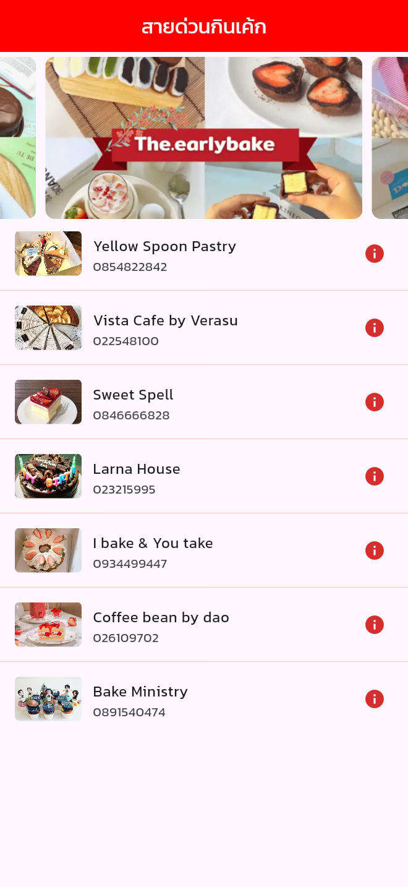
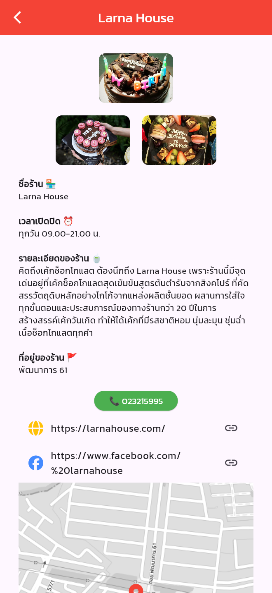
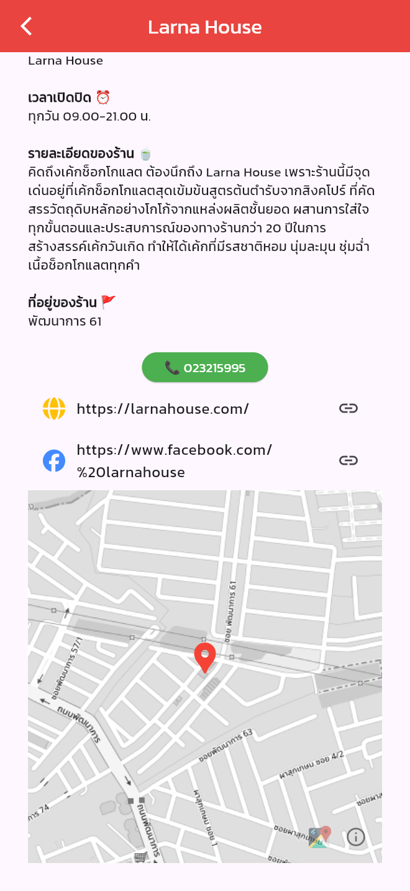

# 06-flutter_cake_shop_project

**สายด่วนกินเค้ก (CAKE CALL FAST)** — a list of 7 cake shops in Bangkok with photos,
opening hours, a call button, website / Facebook links and a map, built from the Figma mockup
"Project: flutter_cake_shop_app" (tested at iPhone 16 Pro Max size, 440 x 956).
Main font: Kanit (google_fonts).

## Screenshots

Captured from the running app at iPhone 16 Pro Max size (440 x 956).

<table>
  <tr>
    <td align="center"><br><b>SplashScreenUI</b><br>หน้าแรก (3 วินาที)</td>
    <td align="center"><br><b>CakeShopListUI</b><br>สไลด์รูป + รายชื่อร้าน</td>
  </tr>
  <tr>
    <td align="center"><br><b>CakeShopDetailUI</b><br>รายละเอียดร้าน Larna House</td>
    <td align="center"><br><b>CakeShopDetailUI</b><br>เลื่อนลง: ปุ่มโทร ลิงก์ และแผนที่</td>
  </tr>
</table>

## Screens

| File | Class | Screen |
| --- | --- | --- |
| `lib/views/splash_screen_ui.dart` | `SplashScreenUI` | Cake background, app name and a loading spinner; goes to the list after 3 seconds |
| `lib/views/cake_shop_list_ui.dart` | `CakeShopListUI` | Auto-playing `CarouselSlider` of 7 cake pictures and a `ListView` of shops (picture, name, phone) |
| `lib/views/cake_shop_detail_ui.dart` | `CakeShopDetailUI` | 3 pictures, name, opening hours, description, address, call button, website / Facebook links and a `FlutterMap` with a red pin |

Shop data is in `lib/data/cake_shop_data.dart` (model: `lib/models/cake_shop.dart`),
copied from the Figma file. It is for learning only — some of it may not be real.

## How the links work

| Tap | Opens |
| --- | --- |
| Green phone button | Phone app (`tel:`) |
| Website / Facebook row | Browser (`url_launcher`) |
| Map | OpenStreetMap tiles in grayscale, centered on the shop |

Android needs the `INTERNET` permission and `<queries>` for `tel` / `https` (added in
`android/app/src/main/AndroidManifest.xml`); iOS lists `tel`, `http`, `https` in
`LSApplicationQueriesSchemes` (`ios/Runner/Info.plist`).

## Packages

google_fonts, font_awesome_flutter, flutter_launcher_icons, carousel_slider, flutter_map,
latlong2, url_launcher

Map data © [OpenStreetMap contributors](https://www.openstreetmap.org/copyright).

## Run

```sh
flutter pub get
flutter run -d chrome
```

## Quality checks

```sh
flutter analyze
flutter test
```
